Harness switch · observation · `warp-arrival-settle-v1` · server side · off by default · planned for the bundle arm

# Warp arrival settle

> Markdown twin of [warp-arrival-settle-v1.html](../warp-arrival-settle-v1.html), generated from the HTML by `just explainer-twins`. The HTML is the source; edit it, not this file.

After a door, stairs or warp, the observation now waits, one emulated frame at a time, until the game's own door/warp task lets go of the player. The model then sees the arrival tile on the new map with field controls free, instead of a frame from the middle of the animation labelled as a dialog, menu or script lock.

## Why: today's settle stops at the wrong moment

The fade settle waits only while the palette is fading or all black. A door has long stretches where neither is true but the game still holds the player: the door opens and the player walks in before any fade starts, and after the fade-in the player walks out and the door closes. A capture there reads `Field controls: locked (dialog, menu, or script; direction presses cannot move)`. In control-2919 this happened at T100 (2F stairs), T143 (house door), T185 (lab door, the model was never told it entered) and T200–T247 (lab exit).



*Per-frame trace on the real ROM from the CLOCK_SET save (scratch tracer, read-only). OFF captures anywhere in 0–57 (and in 122–124) because neither the fade nor the black-palette rule holds. ON keeps waiting while a warp task is live with the lock set, and the black frames between the load task and the exit task are already covered by the fade rule.*

## The rule, per emulated frame



*The hook runs after each emulated frame under the vendor memory lock and only while an observation waits. No wall-clock sleeps. An operator pause still releases a waiting observation at once.*

| Task (pret `field_screen_effect.c`) | Address | When |
|---|---|---|
| `Task_DoDoorWarp` (677) | `0x080AFA89` | door opens, player walks in, door closes |
| `Task_WarpAndLoadMap` (646) | `0x080AFA0D` | fade out, music stop, map load |
| `Task_ExitDoor` (317) | `0x080AF439` | fade in, walk out of a door, door closes |
| `Task_ExitNonAnimDoor` (366) | `0x080AF551` | fade in, one step off stairs |
| `Task_ExitNonDoor` (404) | `0x080AF611` | fade in on a mat or other arrival |

Receipt: each address is the only value referenced from the matching ROM literal pools (US ROM `f3ae0881…`; `Task_WarpAndLoadMap` has exactly the 8 references the source predicts), each starts with a Thumb `push {…, lr}`, they appear in source order, and the live trace sees each one at the expected moment. Details: `docs/findings/2026-10-16_warp-arrival-settle.md`.

## Bound

| Warp (real ROM) | Frames, lock to unlock |
|---|---|
| 2F → 1F stairs | 75 |
| 1F → 2F stairs | 74 |
| House door → Littleroot | 95 |
| Littleroot → Birch's lab | 124 |
| Birch's lab → Littleroot | 137 |

The warp bound is 300 frames, about 2.2 times the longest measured chain. The slowest recorded lane ran at 42.8 frames/s, so a bound hit costs at most about 7 s, under the agent's 15 s observation timeout. If the bound is hit, the observation is returned anyway with the lock line `Field controls: locked (door/stairs/warp animation still running; observe again)`. Fade-only waits keep their 146-frame bound.

## What the model reads (real ROM probe, same press, switch off and on)

The probe replays control-2919 T185: `LEFT, LEFT, UP` from Littleroot (9,17) into the lab door, through the production press tool and game server on port 8041.

Off · probe 2026-10-16T01-24-17_probe_f982 seq 28

```
pressed LEFT, LEFT, UP
Press result: moved (9,17) -> (7,16)
…
Location: LITTLEROOT TOWN
Position: X=7, Y=16, facing up
…
Field controls: locked (dialog, menu, or script; direction presses cannot move)
```

On · probe 2026-10-16T01-24-07_probe_cc89 seq 28

```
pressed LEFT, LEFT, UP
Press result: transitioned (map or screen changed)
…
Location: LITTLEROOT TOWN PROFESSOR BIRCHS LAB
Position: X=6, Y=12, facing up
…
Field controls: available (terrain and objects can still block a direction)
```

*The off text is identical to what control-2919 recorded at T185. On, the observation waited 82 emulated frames (`settle: {frames: 82, reason: "warp"}`). The lab exit waited 90 frames and arrived at (7,17) with controls available; the 1F→2F stairs waited 22 frames and arrived at 2F (7,2); 2F→1F waited 36 and arrived at (8,3). With the switch off, the 2F→1F capture was taken at 1F (8,2), locked, mid step.*

The probe's press tool has transition press results off. With `transition-press-result-v1` also on (as planned for the bundle arm), the same press reads `warped during this press: LITTLEROOT TOWN [map 0/9] (9,17) -> LITTLEROOT TOWN PROFESSOR BIRCHS LAB [map 1/4] (6,12)`. This switch also stops an interface owner in either snapshot from hiding a warp (bundle-3f21 T157, where the press began mid map load): `warped during this press (the map change was already under way when it began): LITTLEROOT TOWN [map 0/9] (7,16) -> LITTLEROOT TOWN PROFESSOR BIRCHS LAB [map 1/4] (6,12)`.

## Recorded fields

With the switch on, every observation's state carries `settle: {frames, reason}`, recorded in the run's `state` events. Reasons: `immediate` (nothing to wait for), `fade`, `warp` (waited and the screen settled), `fade_bound`, `warp_bound` (captured at the bound), `paused` (released by an operator pause). Off, the field is absent and the payload is unchanged.

## Limits

Escalators, spin warps, falls, the Lavaridge gym and link rooms use other tasks and are only held by the fade rule. An arrival that starts a cutscene is held until the exit task ends; the cutscene's lock then reads as today's script lock. The human server has no settle; its readout still names a warp animation lock truthfully.

## Status

Tests on control-2919 archived RAM (seq 1383, 2010, 2884, 3165/3166 held until the unlocked arrival; MOM's dialogue lock at seq 1126 captured at once), the bound, pause release, the observation route, the press results and the production wiring; real-ROM probes on the lab door and the house stairs with the switch on and off. Operator decision 2026-10-16: to be ON in the bundle arm of bundle-v-control only. Not wired yet: `experiments/fixed/bundle-v-control.json` on this branch does not list the switch, so both arms run it off until the M6 integration adds it to the bundle arm's `switches`. No measured runs yet.
