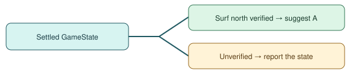

# Verified Waterfall handoff

> Markdown twin of [waterfall-handoff-verification-v1.html](../waterfall-handoff-verification-v1.html), generated from the HTML by `just explainer-twins`. The HTML is the source; edit it, not this file.

## Check the result of turning

At the foot of a waterfall, a direction press can leave the player facing away. The handoff now reads the settled position, field controls, Surf mode, and native movement direction before suggesting A.

With the switch off, navigation reports the planned facing after the turn attempt. The switch does not activate Waterfall for the player.
