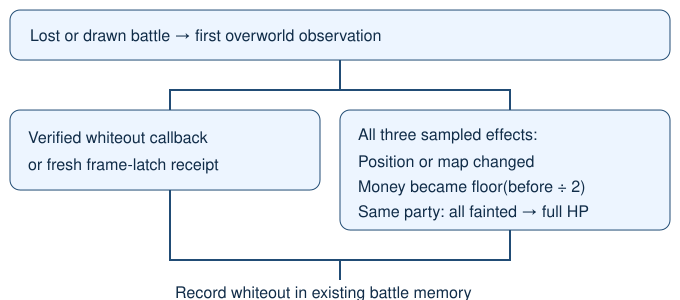

# Native whiteout outcomes

> Markdown twin of [whiteout-outcomes-v2.html](../whiteout-outcomes-v2.html), generated from the HTML by `just explainer-twins`. The HTML is the source; edit it, not this file.

whiteout-outcomes-v2 · Default OFF · Applicable to both arms

## A whiteout can return to the same town

GLM lost to MAY three times in Rustboro City. Each battle returned to Rustboro (16,39). The old map-change rule omitted all three whiteouts.

1. Lost or drawn battle 
   ↓ First overworld state
2. Native callback or fresh receipt 
   **OR all together:** 
   Displacement + exact money halving + same party all fainted → full HP
3. Record whiteout in existing battle memory

## What changes

With v2 ON, the existing latest-whiteout briefing and battle recap use this evidence. With whiteout-healed-v1 also ON, the recap names the observed party HP. The callback reader blackout-transition-v1 remains independent.

With v2 OFF, the previous loss-plus-map-change rule and recap wording are preserved exactly. New and existing presets keep v2 OFF unless explicitly enabled.

## What qualifies

| Observation | V2 result |
|---|---|
| Lost battle, same map, native whiteout receipt | Whiteout |
| Lost battle, displaced position, exact money halving, same identified party all fainted then fully healed | Whiteout |
| Money loss, healing, movement, or map change alone | No whiteout |
| First field state lacks required evidence | No sampled inference; later healing does not rewrite it |

Zero money, missing identities or incomplete party reads require native callback evidence. Sampled observations can miss a real whiteout; this detector does not invent missing evidence.

Source and activation contract

pret/pokeemerald 731ad5bfd6e6f265508d0efcca0ba42f9dcf5881: overworld.c DoWhiteOut halves money, heals the party and warps to the saved heal location. CB2_WhiteOut invokes it after 120 frames. Existing verified US callback: 0x08085F59.

Offline fixtures preserve GLM run 0d5d state records 65354→65369, 72982→72984 and 77543→77545. No historical log is rewritten. This is evidence correction, not measured gameplay benefit.

The operator approved v2 ON in the bundle arm and OFF in control for bundle-v-control-2h and bundle-v-control. Existing briefing and recap consumers stay enabled. Other defaults remain OFF. These recipe changes affect future trials; active and frozen runs stay untouched. No gameplay, GPU or probe launch is authorized here.

