# Window escape route

> Markdown twin of [window-escape-route-v1.html](../window-escape-route-v1.html), generated from the HTML by `just explainer-twins`. The HTML is the source; edit it, not this file.

Switch `window-escape-route-v1` (frontier report H8). Default off; on in the bundle arm only. It needs `bounded-navigation-v1`. No measured runs yet, so no claim that it helps.

## What it fixes

With `full-map-navigation-v1` off, `navigate_to` plans only inside the 15x15 local map around the player. GLM run f3b2 walked up ROUTE101 to (7,7), a pocket under a row of ledges that can be hopped only going down. The open way north lies one column outside the window, so the planner found no route and stopped (seq 3217):

```
Navigation: walked from (7,14) to (7,7), then stopped: no route to (9,0) lies inside the 15x15 local map navigate_to plans over; Exploratory local-map edge tiles (…): (14,9) on the east edge, (9,14) on the south edge; …
```

`navigate_to_target` for the NORTH connection (seq 7624) walks with `navigate_to`, so it stopped there as well. By the frontier report's count, 28 of GLM's 41 replies cut at 4,096 tokens with no tool call came in this place.

## The pocket on ROUTE101


*Tiles are ROUTE101's whole-map rows from the fixture `test-support/window-escape-f3b2.json` (identical to f3b2's 225 recorded window tiles). The route is what the switch's planner did in the test harness, which moves the player by ROUTE101's tile rules without the game: call 1 from (7,7) pressed RIGHT, DOWN, RIGHT, RIGHT, RIGHT and ended at (12,10); later calls ended at (15,5), (11,1) and (9,0).*

Only the first call, from (7,7), differs from OFF. From (12,10) on, the goal lies beyond the window's top edge and the ordinary local planner finds a route toward it, so those calls press the same buttons ON as OFF.

## What happens inside one navigate_to call



*The highlighted boxes are the only behavior change. The next call starts over with the local window.*

The whole-map route uses the same rules as the local one: ledges only in their arrow direction, one-way tiles, heights, people and objects, warps only as the goal, and coordinate scripts whose condition matches now.

## What the model sees

|  | OFF | ON |
|---|---|---|
| State from the game server | no `map_grid` | `map_grid` (the whole current map) added; used only by navigate_to |
| Readout's local map | 15x15 | 15x15, unchanged |
| navigate_to description | today's | gains one sentence: "When no route lies inside the local map, it plans over the whole current map instead." |
| f3b2 at (7,7), goal (9,0) | the recorded refusal, no input | first press RIGHT; ended at (12,10) after 5 presses |
| A goal the local window already reaches | the same presses and status, ON as OFF |  |
| A goal the whole map has no route to either | refused as before, ON as OFF |  |
| `full-map-navigation-v1` on | navigate_to already plans over the whole map; nothing changes |  |

**Off:** no `map_grid` in the state, the local planner's refusal and today's description.

## Wiring


*Two highlighted changes: the server sends the whole map, and navigate_to uses it only when the local window has no route.*

## Status

- Tests: `packages/agent/src/window-escape-route.test.ts` (OFF reproduces f3b2's recorded refusal, ON escapes the pocket and repeated calls reach (9,0), at most 8 attempts, description, unchanged cases, wiring) and `env/tests/env/test_window_escape_route.py` (`map_grid` added, readout unchanged).
- Default off; on in the bundle arm (`switches`) only. No measured runs yet, so no claim that it helps.
- Multi-model review and landing are pending.
