# YES/NO answer readout

> Markdown twin of [yes-no-answer-readout-v1.html](../yes-no-answer-readout-v1.html), generated from the HTML by `just explainer-twins`. The HTML is the source; edit it, not this file.

`yes-no-answer-readout-v1` · server readout switch · bundle-only, default off · approved by Operator 2026-10-21 (8:08 PM ET 2026-10-20)

Run `2026-10-20T19-58-04_qwen36-gpu0_ef9f` set the wall clock and then answered NO on the confirmation, again and again, from turn \~100 to 156 (8:02–8:09 PM ET). The readout said `selected NO; UP/DOWN selects; A accepts selection`, and the model kept pressing A. A decision probe at turn 156 (16 samples per arm) found 0/16 pressed UP then A as recorded, and 8/16 with the line "To answer YES, press UP, then A. Pressing A now answers NO." This switch adds that line.

## What the model reads (ef9f, the state at turn 156)

Off (recorded, byte for byte)

Screen: clock Dialog: none Menu: clock_confirmation; selected NO Interface: clock_confirmation; input ready; selected NO; value 11:24 AM; UP/DOWN selects; A accepts selection; B returns to adjustment Bag: empty …

On

Screen: clock Dialog: none Menu: clock_confirmation; selected NO Interface: clock_confirmation; input ready; selected NO; value 11:24 AM; UP/DOWN selects; A accepts selection; B returns to adjustment To answer YES, press UP, then A. Pressing A now answers NO. B also answers NO. Bag: empty …

The ON text comes from the production reader on raw RAM archive 1468 of that run (fixture `env/tests/env/fixtures/yes-no-ef9f-1468.json`, writable RAM only). Every other line is unchanged. With YES highlighted the line reads "To answer NO, press DOWN, then A. Pressing A now answers YES. B also answers NO."

## Why both sentences are true: the game's box

*pret/pokeemerald 731ad5b: `gText_YesNo` is "YES\\nNO", so YES is the top row. `Menu_ProcessInputNoWrap` (menu.c) answers `sMenu.cursorPos` on A. `Task_SetClock_HandleConfirmInput` treats B like NO. The battle boxes use their own cursor (`gBattleCommunication[1]`) with the same layout and guards.*

## Where the line comes from

*No reader, typed state or JSON changes; replays and decision probes render it from the recorded RAM when the switch is on. The agent only transports the switch. No timeline marks.*

## Which boxes get the line

| Readout | Boxes (phase names) | Game handler | B clause |
|---|---|---|---|
| Interface | name_confirmation, clock_confirmation, starter_confirmation | main_menu.c, wallclock.c, starter_choose.c | B also answers NO |
| Interface | 11 party\_\*\_confirmation boxes | party_menu.c (B falls through to NO) | yes |
| Interface | menu_confirmation, shop/bag/Pokéblock/Pyramid toss, TM/HM, 5 decoration boxes, secret base registry, field_confirmation, pc_toss_confirmation | menu_helpers.c Task_CallYesOrNoCallback (B calls noFunc) | yes |
| Interface | field_yes_no (script `yesnobox`) | script_menu.c Task_HandleYesNoInput | yes |
| Interface | pc_confirmation, 4 move_relearner boxes, save / overwrite / Pyramid retire, clear_save_confirmation, frontier_record_confirmation | pokemon_storage_system.c, move_relearner.c, start_menu.c, clear_save_data_screen.c, battle_main.c | yes |
| Interface | evolution_move_confirmation, egg_hatch_nickname_confirmation, pokeblock_feed_confirmation, slots_quit_confirmation | evolution_scene.c, egg_hatch.c, use_pokeblock.c, slot_machine.c | yes |
| Interface | 4 minigame play-again boxes, trade_confirm, trade_cancel_confirm, 2 Union Room Chat boxes, 3 Union Room prompts, wireless_group_confirmation, factory_rental_confirm, factory_swap_confirm | dodrio, pokemon_jump, berry_crush, berry_blender, trade.c, union_room(\_chat).c, battle_factory_screen.c (some wrap; both sentences still hold) | yes |
| Battle | learn a move, stop learning, the battle's question (use next POKéMON, switch), nickname a catch | battle_script_commands.c Cmd_yesnobox and kin | yes |
| Battle | forfeit box (battle input yes_no) | battle_controller_player.c PlayerHandleYesNoInput | no: B closes it without choosing |

No line when the box is not ready, the highlighted option is unknown, the reader reports a coverage error, or the box is not listed. Left out on purpose: easy_chat and mystery_gift (their readers do not tie the cursor to the step that draws the box), union_room_try_accept_chat_request (the game draws that box in a different state) and wireless_leader_confirmation (the reader can say ready while the box is being erased).

## Status

Tests: `env/tests/env/test_yes_no_answer.py` (every listed phase with YES and NO highlighted, unknown or not-ready selections, battle boxes, the forfeit box, an OFF golden, the ef9f turn-156 evidence and the production observation route) and the agent/viewer registry, bundle-arm and explainer-link tests. Pending experiment `experiments/yes-no-answer-readout-v1.json`, activation NEW_GAME_CREATED. On in the bundle arm of bundle-v-control, bundle-cook-1h and whole-map-cook-1h; off in control. No measured runs yet.
